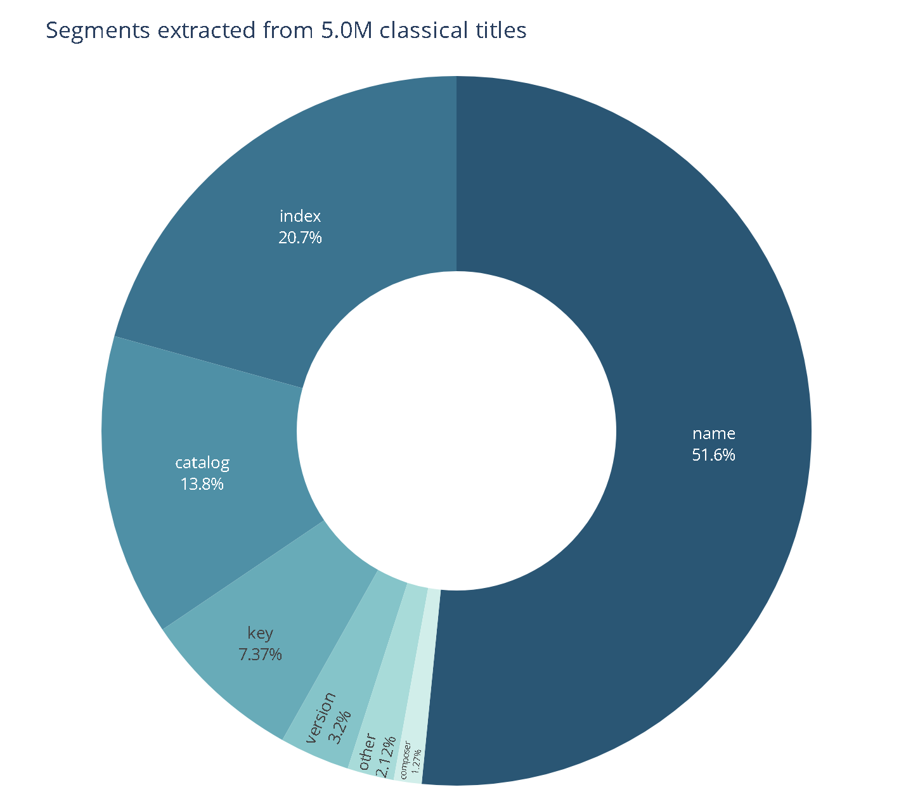
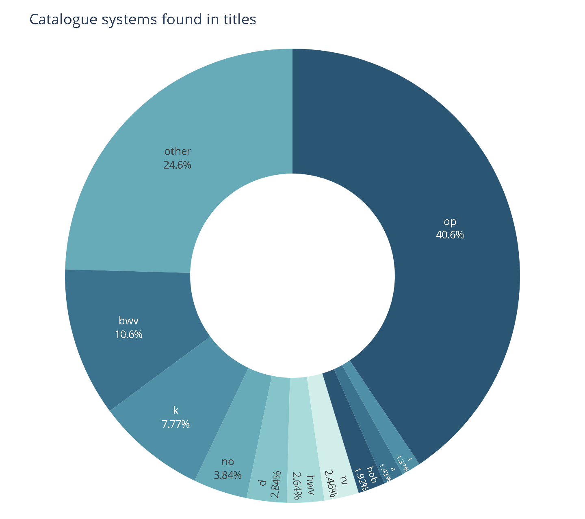
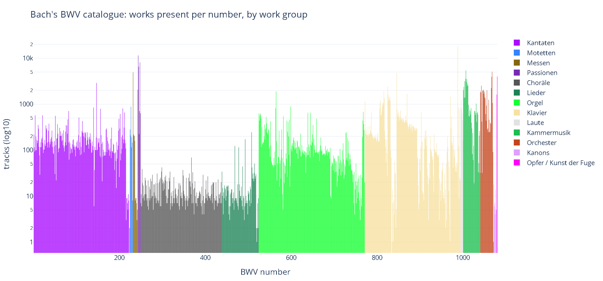
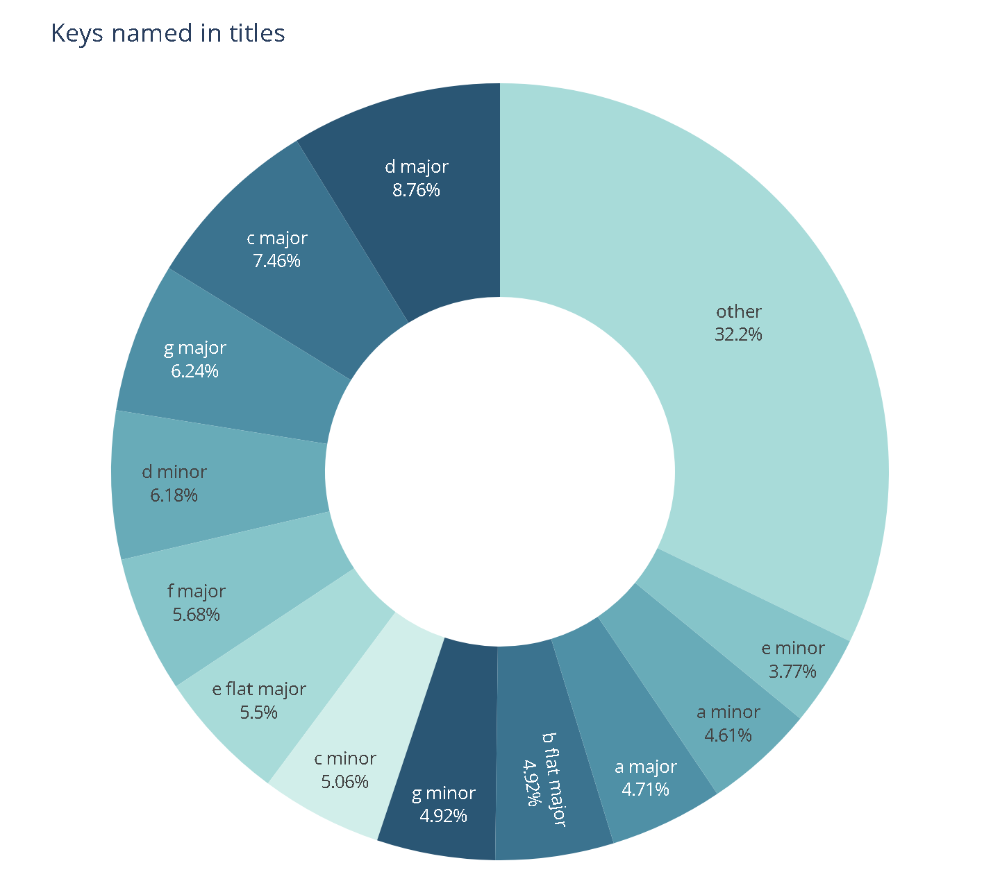
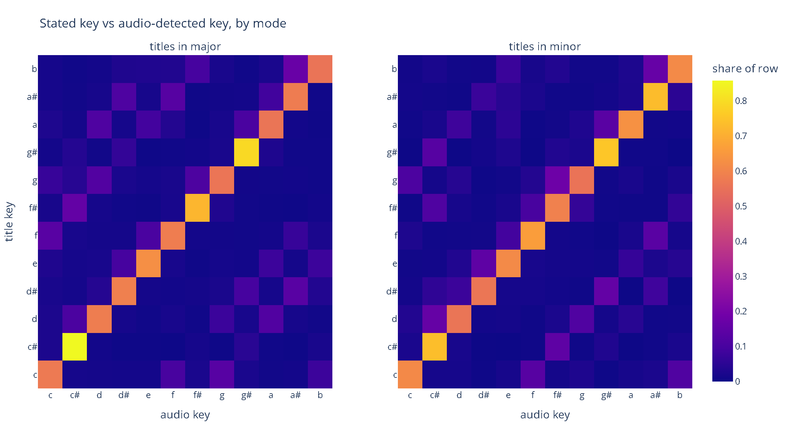

# A structured index for classical music on streaming platforms

Spotify describes a classical recording with the same fields it uses for a pop song
— artist, title, album — work, catalogue number and movement survive
only as free text inside the title. This is a method for recovering them.

## The method

A BERT token classifier — `bert-base-multilingual-cased`, fine-tuned on annotated
titles — decomposes a title into ten segment types:

| Tag | Segment | Example |
|-----|---------|---------|
| `CO` | composer | `Chopin` |
| `N` | name of the work or movement | `Piano Concerto`, `Allegro maestoso` |
| `CA` | catalogue number | `Op. 11`, `BWV 1049`, `K. 331` |
| `I` | index / movement number | `No. 1`, `II.` |
| `K` | key | `E minor` |
| `V` | version, edition or performance qualifier | `Live`, `arr.`, `Remastered` |
| `D` | delimiter | `in`, `,`, `:` |
| `M` | markup | brackets, quotation marks |
| `S` | whitespace | — |
| `O` | other | — |

A title such as

```
Piano Concerto No. 1 in E minor, Op. 11: I. Allegro maestoso
```

is rewritten as

```
<CO>Chopin<D>:<S> <N>Piano Concerto<S> <I>No. 1<S> <D>in<S> <K>E minor<D>,<S> <CA>Op. 11<D>:<S> <I>I.<S> <N>Allegro maestoso
```

which is not a better string but a set of join keys: `Chopin` links the recording to
a composer page, `Op. 11` links it to every other recording of the same work, `I.`
orders the movement inside the work, `E minor` becomes a filter.

## What it looks like at catalogue scale

Applied to the classical portion of Spotify — 5.0 million
titles, 18.3 million extracted segments.



Names and movement indices dominate, followed by catalogue numbers and keys: exactly
the information a work-centric player needs and a track-centric catalogue lacks.



Catalogue numbers are the work identifiers, and they arrive in many numbering
systems at once — Opus, BWV, Köchel, Hoboken, Ryom, Deutsch — which is why a
normalised work identifier has to be constructed rather than read off a field.

Searching this index is exact. Asking for Beethoven's Op. 111 returns 997 entries
from Spotify — every recording of that sonata, and nothing else, rather than
whatever titles happen to contain those characters.



For one composer the index resolves to individual works: simply counting tracks per
BWV number covers Bach's complete output, grouped into its standard categories.



Keys appear in 1,291 different spellings, collapsing to the 24 a listener would
recognise — free text turning into a usable filter.



It also allows verification: comparing the key stated in the title against the key
detected in the audio shows where catalogue metadata and recording agree, and flags
mislabelled, transposed or arranged releases.

## Why this matters

Popular music fits the streaming data model: one artist, one title, one album, and
the artist is who you are looking for. Classical music breaks it in two ways.

Its taxonomy is different. A work is not a recording: one sonata exists as hundreds
of recordings by different pianists, on different labels, in different decades, arrangements/instruments each
containing several movements. The entities a listener cares about are not the ones
the platform indexes.

This mismatch is why Apple Music Classical and IDAGIO exist, and why both had to
build a work-centric, composer-first model themselves. This is an experiment which
turns a flat list of tracks into an index organised the way classical listeners can browse.
